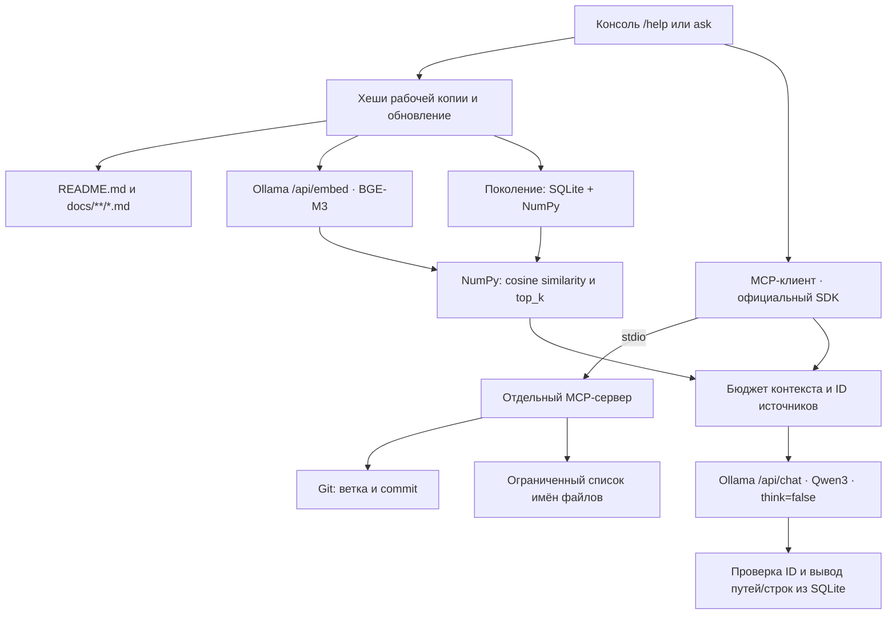

# Ассистент разработчика Outline

Локальное консольное приложение: BGE-M3 ищет по документации Outline, MCP передаёт текущую ветку, commit и список файлов, Qwen3 8B отвечает по-русски с проверяемыми источниками. Облачные API не используются. Сам Outline запускать не нужно; приложение не изменяет его файлы или Git-состояние.

## Установка

Нужны Python, Git и работающая Ollama. Воспроизводимая установка ниже проверяется на **Python 3.14, macOS arm64**. Код использует Python 3.11+, но зафиксированные зависимости могут требовать более новый Python; для точного воспроизведения используйте 3.14. Блокировка обновления индекса использует `fcntl`: поддерживаются macOS/Linux, Windows напрямую не проверялся.

```bash
cd /Users/sergey/ai/aichallenge/aichallenge31
python3.14 -m venv .venv
.venv/bin/python -m pip install -r requirements.lock
.venv/bin/python -m pip install --no-deps --no-build-isolation -e .
cp config.example.toml config.toml
```

`requirements.lock` фиксирует все прямые, транзитивные, тестовые и сборочные зависимости точными версиями. `pyproject.toml` задаёт совместимые диапазоны; официальному MCP SDK установлен предел `<2`, поскольку используется его API v1. После установки приложение работает без доступа к интернету. На этапе установки нужны доступ к PyPI либо заранее загруженные wheels.

Если Ollama ещё не запущена, выполните в другом терминале `ollama serve`. Не запускайте вторую копию, если сервер уже работает. При отсутствии нужных моделей установите именно их:

```bash
ollama pull bge-m3
ollama pull qwen3:8b
```

Приложение не скачивает и не подменяет модели автоматически.

## Команды запуска

Команды выполняются в терминале из корня этого проекта. `.venv/bin/outline-assistant` запускает приложение из виртуального окружения Python; последнее слово выбирает действие. Активировать окружение отдельно при таком запуске не нужно.

```bash
.venv/bin/outline-assistant doctor
.venv/bin/outline-assistant docs
.venv/bin/outline-assistant index
.venv/bin/outline-assistant ask 'Как включить HTTP-логи?'
.venv/bin/outline-assistant chat
```

| Действие | Что делает | Когда использовать |
|---|---|---|
| `doctor` | Проверяет путь к Outline, наличие документов, Git, доступность Ollama, обеих моделей и MCP. Выводит результаты проверок и подсказки при ошибках. | После установки или при проблемах с запуском. |
| `docs` | Показывает относительные пути документов, выбранных текущими правилами `include`. Не строит индекс и не обращается к Ollama. | Чтобы проверить, какие документы попадут в поиск. |
| `index` | Создаёт или обновляет поисковый индекс: разбивает документы на фрагменты, получает их векторы через BGE-M3 и сохраняет данные в SQLite/NumPy. Неизменённые документы повторно не векторизуются. Выводит статистику обновления. | Чтобы заранее подготовить индекс или отдельно проверить индексацию. |
| `ask '<вопрос>'` | Отвечает на один вопрос и завершает работу. Перед ответом обновляет индекс, получает контекст через MCP, ищет фрагменты и обращается к Qwen3. Показывает ответ, ветку, commit и источники. | Для разового вопроса или запуска из скрипта. Текст вопроса с пробелами заключайте в кавычки. |
| `chat` | Открывает интерактивную сессию с приглашением `>`, в которой можно задавать несколько вопросов подряд. | Для работы с ассистентом в диалоговом режиме. |

Для первого знакомства запустите `doctor`, затем `chat`. При желании перед этим посмотрите список через `docs` и подготовьте индекс командой `index`. Отдельный запуск `index` необязателен: перед каждым вопросом приложение само проверяет документы и создаёт или обновляет индекс при необходимости.

После запуска `chat` вводите команды внутри приложения:

```text
/help
/help На чём построен frontend?
/help Какие backend-сервисы нужны Outline?
/help Что настроить для collaboration на отдельном домене?
/help Какая точная минимальная версия PostgreSQL требуется?
/exit
```

| Команда внутри `chat` | Действие |
|---|---|
| `/help` | Краткое описание Outline на основе документации и примеры вопросов. |
| `/help <вопрос>` | Ответ на конкретный вопрос о проекте. |
| `/exit` | Завершение интерактивной сессии. |

`/help` получает описание проекта через тот же RAG-конвейер и показывает примеры. Каждый `/help`, `/help <вопрос>` и `ask` сначала проверяет актуальность индекса. Запуск без подкоманды равен `chat`. История диалога не добавляется к следующему вопросу.

Другая конфигурация: `.venv/bin/outline-assistant --config /path/to/config.toml doctor`. Принудительное восстановление после повреждения: `.venv/bin/outline-assistant index --rebuild`. Ошибка возвращает код 1, Ctrl+C — 130; сообщения прогресса идут в stderr. В `chat` ошибка одного вопроса не завершает сессию.

Диагностика независимо проверяет Git в PATH, каталог и документы, доступность Ollama и обеих моделей, затем действительно запускает MCP-процесс и вызывает оба инструмента. Отсутствие одного компонента не скрывает результаты остальных проверок.

## Настройки

Все параметры перечислены в `config.example.toml`; `config.toml` и `.index/` исключены из Git. Относительные пути в конфигурации разрешаются относительно самого TOML-файла. Без файла используются значения по умолчанию, а `.index` располагается в текущем каталоге.

| Параметр | По умолчанию | Назначение |
|---|---|---|
| `repo_path` | `/Users/sergey/ai/aichallenge/outline` | Локальная рабочая копия |
| `ollama_url` | `http://localhost:11434` | HTTP API Ollama |
| `embedding_model` | `bge-m3` | Модель поиска |
| `chat_model` | `qwen3:8b` | Модель ответов |
| `index_dir` | `.index` | Индекс, обязательно вне Outline |
| `include` | `README.md`, `docs/**/*.md` | Шаблоны отбора документации |
| `chunk_chars` / `overlap_chars` | 1400 / 160 | Размер и максимальное перекрытие в символах |
| `top_k` | 5 | Число результатов векторного поиска |
| `batch_size` | 8 | Фрагментов на запрос embeddings |
| `http_timeout` | 180 секунд | Таймаут сетевой операции Ollama |
| `mcp_timeout` / `git_timeout` | 30 / 10 секунд | Таймаут MCP-вызова и Git-процесса |
| `file_limit` | 80 | Максимум имён файлов от MCP, допустимо до 500 |
| `num_ctx` / `answer_tokens` | 16384 / 1800 | Контекст Qwen и резерв ответа |

Правила `include` действуют только внутри разрешённого корпуса: корневой `README.md` и Markdown в `docs`. Они позволяют сузить отбор, но не включают исходный код. `**/` соответствует также нулю уровней: `docs/**/*.md` выбирает и `docs/SECURITY.md`. Ссылки не обходятся, включая ссылки внутри репозитория; каталоги зависимостей, сборок, `.git`, виртуальные окружения и кэши пропускаются. Команда `docs` показывает фактический список.

## Архитектура



Модули в `src/outline_assistant`: `config`, `documents`, `chunking`, `ollama_client`, `store`, `search`, `mcp_server`, `mcp_client`, `assistant`, `cli`.

MCP-сервер имеет только два инструмента: `get_git_context` и `list_project_files`. Корень передаётся при запуске серверу; инструментам нельзя передать другой корень или произвольную команду. Git выполняется с `--no-optional-locks`. Detached HEAD выводится явно, у репозитория без коммитов SHA равен `null`. Файлы перечисляются ограниченно, результат содержит `truncated`. Сервер ничего не печатает в stdout, кроме MCP-протокола; логи направляются в stderr.

Самостоятельный запуск сервера для MCP-клиента:

```bash
.venv/bin/outline-mcp --repo /Users/sergey/ai/aichallenge/outline
```

Это протокол stdio, а не человекочитаемая консоль. Приложение запускает его автоматически через тот же Python, в котором установлено само.

## Фрагменты и обновление индекса

Разбиение учитывает ATX- и Setext-заголовки, абзацы и fenced code blocks. Большие разделы режутся по ближайшей границе абзаца/строки; очень длинная строка может разделяться посередине. Ограничение измеряется **символами Unicode, не токенами**. Перекрытие до 160 символов по возможности начинается с целой строки. Каждый фрагмент содержит точную подстроку исходника, заголовок раздела и реальные, включительные номера строк с единицы; два фрагмента длинной строки могут иметь одинаковый диапазон строк.

Для `/api/embed` всегда передаётся `truncate=false`: слишком длинный текст вызывает явную ошибку, а не незаметное обрезание. E5-префиксы `query:`/`passage:` не добавляются. Нулевые векторы, NaN/Inf, несовпадение количества или размерностей отклоняются. Векторы нормализуются, поиск — матричное умножение NumPy и стабильная сортировка по косинусному сходству; тексты результатов читаются из SQLite.

Перед каждым вопросом:

1. Повторно прочитать выбранные документы и SHA-256 их байтов, включая незакоммиченные и новые файлы.
2. Сравнить состав и хеши с текущим поколением. Переиспользовать векторы неизменённых документов, получить новые для добавленных и изменённых, убрать удалённые.
3. При смене embedding-модели/digest, правил отбора, пути репозитория или параметров разбиения полностью перестроить индекс. Смена модели ответов, ветки, `top_k` или исходников не требует полного перестроения. Если Ollama меняет размерность без смены digest, при обнаружении этого несовпадения выполняется полная пересборка.
4. После embeddings снова проверить хеши и идентичность модели. При изменении во время операции остановиться с предложением повторить запрос.
5. Подготовить новое `gen-*`: SQLite с документами и фрагментами, `vectors.npy`, манифест с параметрами, digest, размерностью и контрольными суммами. `row_index` в SQLite однозначно соответствует строке матрицы.
6. Синхронизировать файлы и атомарно заменить `CURRENT`. Читатель видит только целиком опубликованное поколение. Один писатель удерживает файловую блокировку; конкурентное обновление получает понятную ошибку.

Ошибка embedding, записи или прерывание до публикации оставляет старый индекс. Сам вопрос при неудачном обновлении завершается ошибкой, чтобы не отвечать по заведомо устаревшей документации. Частично подготовленные и старые поколения не удаляются автоматически; они не используются без указателя `CURRENT`. Для освобождения места можно при остановленных процессах удалить весь свой каталог индекса и выполнить `index`; никогда не удаляйте файлы Outline.

## Ответы и источники

В Qwen передаются вопрос, текущий Git-контекст, ограниченный список имён файлов и найденные фрагменты с ID `S1`, `S2` и т.д. Список файлов подтверждает наличие, но не назначение файлов. Системный промпт считает документы данными, запрещает выполнять вложенные инструкции, требует отделять факты от предположений и признавать нехватку сведений.

Для контекста используется консервативный бюджет **байтов UTF-8**: сумма системного текста и JSON-данных не превышает `num_ctx - answer_tokens - 1024`. Байты не называются токенами: это верхняя оценка для byte-level токенизации, дополнительный резерв оставлен на формат сообщений. При нехватке бюджета сначала сокращается список файлов, затем исключаются целые фрагменты; их текст и диапазоны строк не обрезаются. Вопрос ограничен 3000 байтами. `think=false`, `stream=false`, `temperature=0`; ответ, остановленный по лимиту длины, отклоняется.

Qwen возвращает JSON с абзацами, ID источников и признаком нехватки информации. Неизвестные ID, встроенные ссылки вида `[S99]`, недокументированные URL и некорректный JSON отклоняются. URL допускается только при буквальном наличии в цитируемом тексте. Пути и строки списка источников формирует приложение по индексу, а не модель. Это проверка происхождения ссылок; она **не доказывает**, что каждое предложение логически следует из указанного текста. Содержательное качество проверяется отдельно на реальных ответах.

## Проверки

Обычные автоматические тесты не требуют Ollama:

```bash
.venv/bin/python -m pytest -q
.venv/bin/python -m pip check
```

Они проверяют отбор и symlink-ограничения, заголовки/строки/размеры фрагментов, известные векторы, пустой индекс, добавление/изменение/удаление, отсутствие повторных embeddings, совместимость настроек и моделей, смену размерности, сбой второго пакета, сбой публикации, повреждение файлов, конкурентное обновление, гонку изменения документов, бюджет контекста, источники и ошибки Ollama. Git-сценарии используют временные репозитории. MCP даже в этих тестах — настоящий клиент/сервер через stdio; только ответы Ollama заменены детерминированными данными.

Реальная оценка (требует обе модели Ollama):

```bash
.venv/bin/python evaluation/run.py > evaluation/run.log 2>&1
```

`evaluation/questions.json` содержит 25 русских вопросов, ожидаемый документ и контрольную фразу в нём. 22 вопроса имеют ответ в корпусе, 3 не имеют. Поиск проверяется для всех; ответы генерируются для отмеченных `answer=true` случаев. Hit@k считается по попаданию **фрагмента с ожидаемой фразой**, а не просто файла. Для вопросов без ответа retrieval-метрика не вычисляется: ближайшие фрагменты не доказывают наличие ответа.

Скрипт сохраняет реальные ответы, ранги, строки, оценки, digest моделей и Git-контекст в `evaluation/results.json`. Затем проверяет реальные ответы после изменения документа и переключений ветки во временном репозитории. Хеши документации, ветка, HEAD и `git status` Outline сравниваются до/после. Фактический результат: **19 автоматических тестов прошли; 6 документов / 37 фрагментов / 1024 измерения; Hit@5 = 22/22, Hit@1 = 18/22; 9 ответов Qwen по Outline, включая 3 корректных сообщения об отсутствии данных; 5 реальных Git/обновление-сценариев во временном репозитории прошли**. Установка повторена в чистом venv. Подробный результат и ручной разбор приведены в [evaluation/REPORT.md](evaluation/REPORT.md).

## Ограничения

Корпус состоит только из локальных README и docs. Внешние страницы по ссылкам автоматически **не загружаются**. Исходники, `.env`, версии зависимостей из package.json, production-инструкции внешнего сайта и актуальные цены не входят в знания ассистента. Наличие файла от MCP не раскрывает его содержимое.

Векторный поиск всегда возвращает ближайшие фрагменты; универсального порога «ответа нет» здесь нет. Признание нехватки сведений зависит от Qwen, и проверка ID не устраняет все возможные смысловые ошибки модели. Небольшой корпус и 25 вопросов не заменяют широкую оценку качества. Получение Git-контекста и чтение документов не являются единой Git-транзакцией: при одновременном редактировании рабочей копии повторите вопрос. Модель может занять значительную память; холодная загрузка медленнее последующих запросов.

API сверены с официальными источниками: [MCP Python SDK v1](https://github.com/modelcontextprotocol/python-sdk/tree/v1.x), [Ollama embed](https://docs.ollama.com/api/embed), [Ollama chat](https://docs.ollama.com/api/chat).
