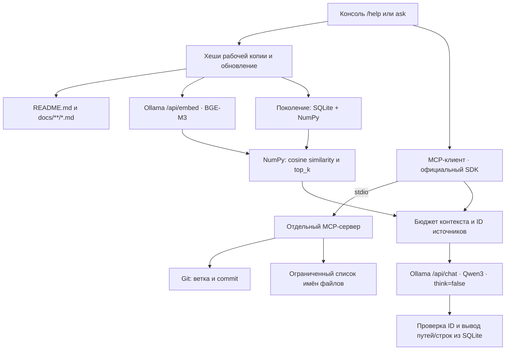

# Ассистент разработчика Outline

Локальное консольное приложение: BGE-M3 ищет по документации Outline, MCP передаёт текущую ветку, commit и список файлов, Qwen3 8B отвечает по-русски с проверяемыми источниками. Облачные API не используются. Сам Outline запускать не нужно. `/help` и ревью PR читают проект; файловый режим `task` готовит Markdown в отдельном каталоге и записывает его в выбранный проект только по явному `--apply` или `apply-run`. Git-состояние приложение не переключает.

## Установка

Нужны Python, Git и работающая Ollama. Воспроизводимая установка ниже проверяется на **Python 3.14, macOS arm64**. Код использует Python 3.11+, но зафиксированные зависимости могут требовать более новый Python; для точного воспроизведения используйте 3.14. Блокировка обновления индекса использует `fcntl`: поддерживаются macOS/Linux, Windows напрямую не проверялся.

```bash
cd /Users/sergey/ai/aichallenge/aichallenge31
python3.14 -m venv .venv
.venv/bin/python -m pip install -r requirements.lock
.venv/bin/python -m pip install --no-deps --no-build-isolation -e .
cp config.example.toml config.toml
```

`requirements.lock` фиксирует все прямые, транзитивные, тестовые и сборочные зависимости точными версиями. `pyproject.toml` задаёт совместимые диапазоны; официальному MCP SDK установлен предел `<2`, поскольку используется его API v1. После установки приложение работает без доступа к интернету. На этапе установки нужны доступ к PyPI либо заранее загруженные wheels.

Если Ollama ещё не запущена, выполните в другом терминале `ollama serve`. Не запускайте вторую копию, если сервер уже работает. При отсутствии нужных моделей установите именно их:

```bash
ollama pull bge-m3
ollama pull qwen3:8b
```

Приложение не скачивает и не подменяет модели автоматически.

## Команды запуска

Команды выполняются в терминале из корня этого проекта. `.venv/bin/outline-assistant` запускает приложение из виртуального окружения Python; последнее слово выбирает действие. Активировать окружение отдельно при таком запуске не нужно.

```bash
.venv/bin/outline-assistant doctor
.venv/bin/outline-assistant docs
.venv/bin/outline-assistant index
.venv/bin/outline-assistant ask 'Как включить HTTP-логи?'
.venv/bin/outline-assistant chat
```

| Действие | Что делает | Когда использовать |
|---|---|---|
| `doctor` | Проверяет путь к Outline, наличие документов, Git, доступность Ollama, обеих моделей и MCP. Выводит результаты проверок и подсказки при ошибках. | После установки или при проблемах с запуском. |
| `docs` | Показывает относительные пути документов, выбранных текущими правилами `include`. Не строит индекс и не обращается к Ollama. | Чтобы проверить, какие документы попадут в поиск. |
| `index` | Создаёт или обновляет поисковый индекс: разбивает документы на фрагменты, получает их векторы через BGE-M3 и сохраняет данные в SQLite/NumPy. Неизменённые документы повторно не векторизуются. Выводит статистику обновления. | Чтобы заранее подготовить индекс или отдельно проверить индексацию. |
| `ask '<вопрос>'` | Отвечает на один вопрос и завершает работу. Перед ответом обновляет индекс, получает контекст через MCP, ищет фрагменты и обращается к Qwen3. Показывает ответ, ветку, commit и источники. | Для разового вопроса или запуска из скрипта. Текст вопроса с пробелами заключайте в кавычки. |
| `chat` | Открывает интерактивную сессию с приглашением `>`, в которой можно задавать несколько вопросов подряд. | Для работы с ассистентом в диалоговом режиме. |

Для первого знакомства запустите `doctor`, затем `chat`. При желании перед этим посмотрите список через `docs` и подготовьте индекс командой `index`. Отдельный запуск `index` необязателен: перед каждым вопросом приложение само проверяет документы и создаёт или обновляет индекс при необходимости.

После запуска `chat` вводите команды внутри приложения:

```text
/help
/help На чём построен frontend?
/help Какие backend-сервисы нужны Outline?
/help Что настроить для collaboration на отдельном домене?
/help Какая точная минимальная версия PostgreSQL требуется?
/exit
```

| Команда внутри `chat` | Действие |
|---|---|
| `/help` | Краткое описание Outline на основе документации и примеры вопросов. |
| `/help <вопрос>` | Ответ на конкретный вопрос о проекте. |
| `/exit` | Завершение интерактивной сессии. |

`/help` получает описание проекта через тот же RAG-конвейер и показывает примеры. Каждый `/help`, `/help <вопрос>` и `ask` сначала проверяет актуальность индекса. Запуск без подкоманды равен `chat`. История диалога не добавляется к следующему вопросу.

Другая конфигурация: `.venv/bin/outline-assistant --config /path/to/config.toml doctor`. Принудительное восстановление после повреждения: `.venv/bin/outline-assistant index --rebuild`. Ошибка возвращает код 1, Ctrl+C — 130; сообщения прогресса идут в stderr. В `chat` ошибка одного вопроса не завершает сессию.

Диагностика независимо проверяет Git в PATH, каталог и документы, доступность Ollama и обеих моделей, затем действительно запускает MCP-процесс и вызывает оба инструмента. Отсутствие одного компонента не скрывает результаты остальных проверок.

## Задачи над файлами: поиск, отчёт и обновление документации

`task` запускает многошаговый цикл Qwen3 8B: модель сама выбирает поиск и чтение файлов через настоящий MCP/stdio, использует BGE-M3 для смыслового поиска, готовит изменения и вызывает preview. По умолчанию рабочая копия остаётся неизменной.

```bash
.venv/bin/outline-assistant task 'Найди использования shallowEqual, объясни связи и тесты, создай отчёт в reports'
.venv/bin/outline-assistant task 'Обнови документацию API по изменениям кода рабочей копии'
.venv/bin/outline-assistant task --base HEAD~1 'Обнови документацию по изменениям относительно указанной базы'
```

Без `--base` сравнение — **HEAD → текущее рабочее дерево**, включая staged, unstaged и untracked. С `--base REF` сравнивается указанный commit с рабочей копией; основная ветка и merge-base автоматически не выбираются. Цели задаются без списка файлов. Если изменений кода нет, второй сценарий может завершиться `no_changes`.

Результат печатает `run_id` и каталог `.task-runs/<run_id>/`: `report.md`, `changes.patch`, `manifest.json`, `events.jsonl`, подготовленные версии `files/` и исходные `originals/`. Имена файлов внутри этих двух каталогов — SHA-256 относительного пути; соответствие находится в manifest. **`prepared` означает «подготовлено», `applied` — «записано».**

**Текущий статус файлового режима:** автономное обновление документации Outline пока не готово к надёжному демо. Реальные повторы пользовательского запроса выявили как `partial`, так и `prepared` с неверным содержанием. Автоматические тесты проверяют механизм и ограничения, но не доказывают корректность текста Qwen3 8B. Не применяйте пакет по одному статусу `prepared`; [журнал проверок и оставшаяся проблема](evaluation/day34/docs-demo-fix/REPORT.md) описывают фактические результаты.

Применение сохранённого пакета к проекту из выбранной конфигурации:

```bash
# Сначала изучите report.md, changes.patch и events.jsonl выбранного запуска.
.venv/bin/outline-assistant --config config.toml apply-run RUN_ID
# Либо заранее разрешите применение после успешного preview и проверок:
.venv/bin/outline-assistant --config config.toml task --apply 'Обнови документацию по изменениям кода'
```

`apply-run` не вызывает LLM/MCP/Ollama: он использует сохранённые файлы и полные хеши. Изменение прочитанного исходника, целевого документа или HEAD блокирует пакет с `conflict`; уже применённый пакет возвращает no-op, пока итоговые файлы, источники и HEAD совпадают. Существующие пользовательские изменения входят в базу точечных замен и сохраняются.

В `chat` доступна `/task [--apply] [--base REF] <цель>`. Обычные `/help` и `review-pr` не получают инструментов подготовки или записи файлов. По умолчанию разрешена запись только в `README.md`, `docs/**/*.md`, `reports/**/*.md`; параметры `task_*` перечислены в примере конфигурации. Каталог запусков должен быть вне целевого проекта и индексов и исключён из Git.

[Подробное руководство](docs/FILE_TASKS.md): архитектура, ограничения поиска, ссылки/хеши и восстановление после сбоя. [План ручного показа файлового режима](docs/DEMO_FILE_TASKS.md): непосредственно в существующем Outline, без клонирования — найти прямые импорты `shallowEqual` (проверенная упрощённая цель), изменить условие HTTP-логирования и обновить существующий README через preview и apply-run. [Результаты настоящих прогонов](evaluation/day34/REPORT.md) отделены от автоматических тестов с фиктивными моделями. При разработке Outline использовался только для dry-run, а запись проверялась во временных проектах; новый ручной сценарий применения к Outline пока не выполнялся.

## Настройки

Все параметры перечислены в `config.example.toml`; `config.toml` и `.index/` исключены из Git. Относительные пути в конфигурации разрешаются относительно самого TOML-файла. Без файла используются значения по умолчанию, а `.index` располагается в текущем каталоге.

| Параметр | По умолчанию | Назначение |
|---|---|---|
| `repo_path` | `/Users/sergey/ai/aichallenge/outline` | Локальная рабочая копия |
| `ollama_url` | `http://localhost:11434` | HTTP API Ollama |
| `embedding_model` | `bge-m3` | Модель поиска |
| `chat_model` | `qwen3:8b` | Модель ответов |
| `index_dir` | `.index` | Индекс, обязательно вне Outline |
| `include` | `README.md`, `docs/**/*.md` | Шаблоны отбора документации |
| `chunk_chars` / `overlap_chars` | 1400 / 160 | Размер и максимальное перекрытие в символах |
| `top_k` | 5 | Число результатов векторного поиска |
| `batch_size` | 8 | Фрагментов на запрос embeddings |
| `http_timeout` | 180 секунд | Таймаут сетевой операции Ollama |
| `mcp_timeout` / `git_timeout` | 30 / 10 секунд | Таймаут MCP-вызова и Git-процесса |
| `file_limit` | 80 | Максимум имён файлов от MCP, допустимо до 500 |
| `num_ctx` / `answer_tokens` | 16384 / 1800 | Контекст Qwen и резерв ответа |

Правила `include` действуют только внутри разрешённого корпуса: корневой `README.md` и Markdown в `docs`. Они позволяют сузить отбор, но не включают исходный код. `**/` соответствует также нулю уровней: `docs/**/*.md` выбирает и `docs/SECURITY.md`. Ссылки не обходятся, включая ссылки внутри репозитория; каталоги зависимостей, сборок, `.git`, виртуальные окружения и кэши пропускаются. Команда `docs` показывает фактический список.

## Архитектура



Модули в `src/outline_assistant`: `config`, `documents`, `chunking`, `ollama_client`, `store`, `search`, `mcp_server`, `mcp_client`, `assistant`, `cli`.

MCP-сервер имеет только два инструмента: `get_git_context` и `list_project_files`. Корень передаётся при запуске серверу; инструментам нельзя передать другой корень или произвольную команду. Git выполняется с `--no-optional-locks`. Detached HEAD выводится явно, у репозитория без коммитов SHA равен `null`. Файлы перечисляются ограниченно, результат содержит `truncated`. Сервер ничего не печатает в stdout, кроме MCP-протокола; логи направляются в stderr.

Самостоятельный запуск сервера для MCP-клиента:

```bash
.venv/bin/outline-mcp --repo /Users/sergey/ai/aichallenge/outline
```

Это протокол stdio, а не человекочитаемая консоль. Приложение запускает его автоматически через тот же Python, в котором установлено само.

## Фрагменты и обновление индекса

Разбиение учитывает ATX- и Setext-заголовки, абзацы и fenced code blocks. Большие разделы режутся по ближайшей границе абзаца/строки; очень длинная строка может разделяться посередине. Ограничение измеряется **символами Unicode, не токенами**. Перекрытие до 160 символов по возможности начинается с целой строки. Каждый фрагмент содержит точную подстроку исходника, заголовок раздела и реальные, включительные номера строк с единицы; два фрагмента длинной строки могут иметь одинаковый диапазон строк.

Для `/api/embed` всегда передаётся `truncate=false`: слишком длинный текст вызывает явную ошибку, а не незаметное обрезание. E5-префиксы `query:`/`passage:` не добавляются. Нулевые векторы, NaN/Inf, несовпадение количества или размерностей отклоняются. Векторы нормализуются, поиск — матричное умножение NumPy и стабильная сортировка по косинусному сходству; тексты результатов читаются из SQLite.

Перед каждым вопросом:

1. Повторно прочитать выбранные документы и SHA-256 их байтов, включая незакоммиченные и новые файлы.
2. Сравнить состав и хеши с текущим поколением. Переиспользовать векторы неизменённых документов, получить новые для добавленных и изменённых, убрать удалённые.
3. При смене embedding-модели/digest, правил отбора, пути репозитория или параметров разбиения полностью перестроить индекс. Смена модели ответов, ветки, `top_k` или исходников не требует полного перестроения. Если Ollama меняет размерность без смены digest, при обнаружении этого несовпадения выполняется полная пересборка.
4. После embeddings снова проверить хеши и идентичность модели. При изменении во время операции остановиться с предложением повторить запрос.
5. Подготовить новое `gen-*`: SQLite с документами и фрагментами, `vectors.npy`, манифест с параметрами, digest, размерностью и контрольными суммами. `row_index` в SQLite однозначно соответствует строке матрицы.
6. Синхронизировать файлы и атомарно заменить `CURRENT`. Читатель видит только целиком опубликованное поколение. Один писатель удерживает файловую блокировку; конкурентное обновление получает понятную ошибку.

Ошибка embedding, записи или прерывание до публикации оставляет старый индекс. Сам вопрос при неудачном обновлении завершается ошибкой, чтобы не отвечать по заведомо устаревшей документации. Частично подготовленные и старые поколения не удаляются автоматически; они не используются без указателя `CURRENT`. Для освобождения места можно при остановленных процессах удалить весь свой каталог индекса и выполнить `index`; никогда не удаляйте файлы Outline.

## Ответы и источники

В Qwen передаются вопрос, текущий Git-контекст, ограниченный список имён файлов и найденные фрагменты с ID `S1`, `S2` и т.д. Список файлов подтверждает наличие, но не назначение файлов. Системный промпт считает документы данными, запрещает выполнять вложенные инструкции, требует отделять факты от предположений и признавать нехватку сведений.

Для контекста используется консервативный бюджет **байтов UTF-8**: сумма системного текста и JSON-данных не превышает `num_ctx - answer_tokens - 1024`. Байты не называются токенами: это верхняя оценка для byte-level токенизации, дополнительный резерв оставлен на формат сообщений. При нехватке бюджета сначала сокращается список файлов, затем исключаются целые фрагменты; их текст и диапазоны строк не обрезаются. Вопрос ограничен 3000 байтами. `think=false`, `stream=false`, `temperature=0`; ответ, остановленный по лимиту длины, отклоняется.

Qwen возвращает JSON с абзацами, ID источников и признаком нехватки информации. Неизвестные ID, встроенные ссылки вида `[S99]`, недокументированные URL и некорректный JSON отклоняются. URL допускается только при буквальном наличии в цитируемом тексте. Пути и строки списка источников формирует приложение по индексу, а не модель. Это проверка происхождения ссылок; она **не доказывает**, что каждое предложение логически следует из указанного текста. Содержательное качество проверяется отдельно на реальных ответах.

## Проверки

Обычные автоматические тесты не требуют Ollama:

```bash
.venv/bin/python -m pytest -q
.venv/bin/python -m pip check
```

Они проверяют отбор и symlink-ограничения, заголовки/строки/размеры фрагментов, известные векторы, пустой индекс, добавление/изменение/удаление, отсутствие повторных embeddings, совместимость настроек и моделей, смену размерности, сбой второго пакета, сбой публикации, повреждение файлов, конкурентное обновление, гонку изменения документов, бюджет контекста, источники и ошибки Ollama. Git-сценарии используют временные репозитории. MCP даже в этих тестах — настоящий клиент/сервер через stdio; только ответы Ollama заменены детерминированными данными.

Реальная оценка (требует обе модели Ollama):

```bash
.venv/bin/python evaluation/run.py > evaluation/run.log 2>&1
```

`evaluation/questions.json` содержит 25 русских вопросов, ожидаемый документ и контрольную фразу в нём. 22 вопроса имеют ответ в корпусе, 3 не имеют. Поиск проверяется для всех; ответы генерируются для отмеченных `answer=true` случаев. Hit@k считается по попаданию **фрагмента с ожидаемой фразой**, а не просто файла. Для вопросов без ответа retrieval-метрика не вычисляется: ближайшие фрагменты не доказывают наличие ответа.

Скрипт сохраняет реальные ответы, ранги, строки, оценки, digest моделей и Git-контекст в `evaluation/results.json`. Затем проверяет реальные ответы после изменения документа и переключений ветки во временном репозитории. Хеши документации, ветка, HEAD и `git status` Outline сравниваются до/после. Фактический результат: **19 автоматических тестов прошли; 6 документов / 37 фрагментов / 1024 измерения; Hit@5 = 22/22, Hit@1 = 18/22; 9 ответов Qwen по Outline, включая 3 корректных сообщения об отсутствии данных; 5 реальных Git/обновление-сценариев во временном репозитории прошли**. Установка повторена в чистом venv. Подробный результат и ручной разбор приведены в [evaluation/REPORT.md](evaluation/REPORT.md).

## Автоматическое ревью PR (Day 32)

[План демонстрации](docs/DEMO.md): подготовка, `/help`, учебные коммиты в `/Users/sergey/ai/aichallenge/outline` без клонирования, PR с ошибкой, исправление и обновление одного комментария, ожидаемые результаты и резервный сценарий.

Ассистент расширен ревью PR в `metalice80/outline_t`. Существующие команды и `/help` сохранены. Ревью получает метаданные, diff и файлы через MCP, анализирует изолированный снимок `merge_base → head`, использует RAG по документации и TypeScript/JavaScript, затем сохраняет `review.json` и `review.md` с источниками, покрытием и статусом.

```bash
.venv/bin/outline-assistant doctor --review
# 123 замените номером существующего PR
.venv/bin/outline-assistant review-pr --repo metalice80/outline_t --number 123 --output-dir review-output/pr-123
.venv/bin/outline-assistant cleanup-review
```

`review-pr` ничего не публикует. `publish-review` — отдельная команда без LLM; по умолчанию она отключена (`publish_enabled=false`). Workflow вызывает установленную доверенную версию ассистента и обновляет один собственный комментарий. Шаблон находится в `integrations/github/ai-review.yml`; для событий PR он должен быть размещён в самом fork, не в репозитории ассистента.

RAG ревью индексирует до **1000 файлов** (`review_max_index_files`). Изменённые и связанные файлы получают приоритет; весь индекс не передаётся в контекст модели. Неизменённые эмбеддинги переиспользуются. Сравнение времени для 80 и 1000 файлов с настоящими Ollama/MCP: [результаты замера](evaluation/day32/index-benchmark/REPORT.md).

Подробные команды, настройки, устройство контекста, установка macOS self-hosted runner и границы внедрения: [docs/AI_REVIEW.md](docs/AI_REVIEW.md). Результаты локальной разработки: [evaluation/day32/REPORT.md](evaluation/day32/REPORT.md). Текущее внедрение и настоящий PR: [evaluation/day32/DEPLOYMENT.md](evaluation/day32/DEPLOYMENT.md). Внешний цикл проверен на PR #1: два успешных запуска, один комментарий бота обновлён после исправляющего commit. Runner установлен и запущен без системного автозапуска. План и внешние блокировки: [TODO.md](TODO.md).

## Повторение демо на новом компьютере

Ниже описана установка на другом **Mac** с тем же GitHub-аккаунтом `metalice80` и fork `metalice80/outline_t`. Проверенная среда — macOS arm64 и Python 3.14. Для Intel Mac выбирайте архитектуру x64 при скачивании runner. Нативная Windows-установка этого ассистента не поддерживается текущим файловым lock на `fcntl`; приведённые команды предназначены для macOS.

### 1. Что переносится и какие каталоги нужны

Перед переносом закоммитьте изменения ассистента и отправьте ветку `day32` в `metalice80/aichallenge31`: локальные незакоммиченные файлы на новый компьютер не попадут. Если версия позднее слита в другую ветку или отмечена тегом, клонируйте соответствующую проверенную ревизию вместо `day32`.

| Каталог на новом компьютере | Откуда берётся и для чего нужен |
|---|---|
| `~/ai/aichallenge/aichallenge31` | Клон ассистента: код, зависимости, тесты, документация и шаблон workflow |
| `~/ai/aichallenge/outline` | Клон fork `metalice80/outline_t`: документы для `/help` и рабочая копия для демонстрационных коммитов |
| `~/ai/outline-review-runtime/venv` | Новое Python-окружение с обычной установленной версией ассистента для Actions |
| `~/ai/outline-review-runtime/config.toml` | Локальная конфигурация новой машины, создаётся вручную |
| `~/ai/outline-review-runtime/runner` | Официальная программа GitHub Actions runner, отдельно скачивается и регистрируется |
| `~/ai/outline-review-runtime/help-index`, `git-cache`, `rag-cache` | Создаются ассистентом по мере работы; из Git не загружаются |

Папка `outline-review-runtime` целиком **не хранится в репозитории**. `.venv`, локальные конфигурации и индексы также не переносятся через Git. Не копируйте старые виртуальные окружения или зарегистрированный runner с его служебными учётными данными: на новой машине создаются новые. Для самой демонстрации дополнительных временных клонов не требуется — оба коммита делаются в рабочей копии `outline`.

### 2. Инструменты, модели и доступ к GitHub

Установите Git, Python 3.14 и [Ollama](https://ollama.com/download). Проверьте `git --version` и `python3.14 --version`. Настройте SSH-доступ нового компьютера к GitHub под аккаунтом `metalice80`; он понадобится для clone/push. В браузере войдите в этот же аккаунт с доступом к настройкам fork.

Запустите приложение Ollama. Если используете CLI-сервер, выполните `ollama serve` в отдельном терминале; второй сервер поверх работающего не запускайте. Затем скачайте модели:

```bash
ollama pull bge-m3
ollama pull qwen3:8b
ollama list
```

Ассистент ожидает Ollama по `http://localhost:11434`. Внешний доступ к этому порту для GitHub Actions не нужен: self-hosted runner работает на том же компьютере. Загрузка моделей и первоначальная индексация требуют времени. Node.js, Yarn, PostgreSQL, Redis и запуск приложения Outline для этого демо не нужны: ассистент читает код, не исполняя его.

### 3. Клонирование и локальная установка ассистента

Следующие блоки выполняйте последовательно в одном терминале. Переменные содержат пути именно новой машины. При открытии нового терминала повторите их объявления; не присваивайте другое значение системной переменной `HOME`.

```bash
export OUTLINE_ASSISTANT_DIR="$HOME/ai/aichallenge/aichallenge31"
export OUTLINE_SOURCE_DIR="$HOME/ai/aichallenge/outline"
export OUTLINE_RUNTIME_DIR="$HOME/ai/outline-review-runtime"

mkdir -p "$HOME/ai/aichallenge"
git clone --branch day32 git@github.com:metalice80/aichallenge31.git "$OUTLINE_ASSISTANT_DIR"
git clone git@github.com:metalice80/outline_t.git "$OUTLINE_SOURCE_DIR"
git -C "$OUTLINE_SOURCE_DIR" remote add upstream https://github.com/outline/outline.git
git -C "$OUTLINE_SOURCE_DIR" remote -v

cd "$OUTLINE_ASSISTANT_DIR"
python3.14 -m venv .venv
.venv/bin/python -m pip install -r requirements.lock
.venv/bin/python -m pip install --no-deps --no-build-isolation -e .
.venv/bin/python -m pip check
cp -n config.example.toml config.toml
```

Команды клонирования предназначены для новых каталогов. Если проекты уже есть, используйте их, предварительно проверив remotes, ветку и пользовательские изменения. `origin` Outline должен указывать на `metalice80/outline_t`, `upstream` — на исходный `outline/outline`.

Откройте локальный `config.toml` ассистента и замените `repo_path`:

```toml
repo_path = "~/ai/aichallenge/outline"
```

Показан путь для предложенной структуры каталогов. При другой структуре укажите свой путь. Приложение разворачивает `~`; строку `$HOME` в TOML оно не подставляет. Остальные настройки можно оставить из примера, включая `review_max_index_files=1000` и `publish_enabled=false`. Относительные пути кешей разрешаются относительно файла конфигурации. `cp -n` сохраняет уже существующий конфиг — при повторной установке проверьте его, а не перезаписывайте.

Проверьте локальную установку и подготовьте документацию для `/help`:

```bash
cd "$OUTLINE_ASSISTANT_DIR"
.venv/bin/outline-assistant doctor
.venv/bin/outline-assistant index
.venv/bin/outline-assistant ask 'Как включить HTTP-логи?'
.venv/bin/python -m pytest -q
```

Ожидается успешная диагностика, ответ с источниками и прошедшие тесты. Команда `index` строит индекс документации `/help`, **не** индекс кода PR. Тесты используют фикстуры моделей/API; `doctor`, `index` и `ask` обращаются к настоящим локальным сервисам.

### 4. Создание доверенной установки outline-review-runtime

Рабочая `.venv` удобна для разработки, но Actions должен использовать отдельный обычный установленный пакет. Создайте его из проверенной ревизии ассистента:

```bash
mkdir -p "$OUTLINE_RUNTIME_DIR"
python3.14 -m venv "$OUTLINE_RUNTIME_DIR/venv"
"$OUTLINE_RUNTIME_DIR/venv/bin/python" -m pip install \
  -r "$OUTLINE_ASSISTANT_DIR/requirements.lock"
"$OUTLINE_RUNTIME_DIR/venv/bin/python" -m pip install \
  --no-deps --no-build-isolation "$OUTLINE_ASSISTANT_DIR"
"$OUTLINE_RUNTIME_DIR/venv/bin/python" -m pip check
```

Здесь установка **без `-e`**: изменение исходников ассистента не меняет автоматически код, который исполняет runner.

Создайте `$OUTLINE_RUNTIME_DIR/config.toml` со следующим содержимым. Это отдельный конфиг, не конфигурация из рабочей копии ассистента:

```toml
repo_path = "~/ai/aichallenge/outline"
index_dir = "~/ai/outline-review-runtime/help-index"
review_git_dir = "~/ai/outline-review-runtime/git-cache"
review_index_dir = "~/ai/outline-review-runtime/rag-cache"
github_repo = "metalice80/outline_t"
ollama_url = "http://localhost:11434"
embedding_model = "bge-m3"
chat_model = "qwen3:8b"
review_max_index_files = 1000
publish_enabled = false
publication_author = "github-actions[bot]"
```

Если выбрали другие каталоги, замените все четыре пути. Остальные параметры берутся из настроек установленного пакета. Затем:

```bash
chmod 600 "$OUTLINE_RUNTIME_DIR/config.toml"
"$OUTLINE_RUNTIME_DIR/venv/bin/outline-assistant" \
  --config "$OUTLINE_RUNTIME_DIR/config.toml" doctor --review
```

`MCP/файлы: 80; усечён: True` в диагностике относится к списку имён файлов для `/help` (`file_limit`), а не к лимиту RAG ревью в 1000 файлов. `authenticated=False` и `НЕ ПРОВЕРЕНО runners` при отсутствии локального токена допустимы: публичный PR читается без токена, а статус runner нужно проверить в GitHub. Для workflow токен `GITHUB_TOKEN` выдаётся GitHub автоматически; сохранять личный токен в TOML не требуется.

### 5. Откуда берётся runner и как его зарегистрировать

Runner — самостоятельная программа GitHub, а не часть Python-пакета ассистента. В fork откройте [Settings → Actions → Runners](https://github.com/metalice80/outline_t/settings/actions/runners), нажмите **New self-hosted runner**, выберите ОС и архитектуру нового компьютера: для Apple Silicon — macOS/ARM64.

Создайте каталог для программы:

```bash
mkdir -p "$OUTLINE_RUNTIME_DIR/runner"
cd "$OUTLINE_RUNTIME_DIR/runner"
```

GitHub покажет актуальные команды скачивания архива, проверки checksum, распаковки и регистрации через `config.sh`. Выполните их в этом каталоге. Поскольку каталог уже создан, не повторяйте предложенные GitHub `mkdir actions-runner` / `cd actions-runner`: архив должен распаковаться непосредственно в выбранную папку `runner`. После распаковки в ней появятся `config.sh`, `run.sh`, `bin/` и другие файлы.

Не используйте старый номер версии архива или регистрационный токен из прошлой установки. Команда `config.sh` должна указывать на `https://github.com/metalice80/outline_t`. При регистрации задайте уникальное имя, например `outline-ai-review-new-mac`, сохраните стандартные метки и добавьте **`ai-review`**. Можно оставить рабочую папку `_work` по умолчанию. Регистрационный токен временный; не добавляйте его в документацию или Git. Подробности: [официальная инструкция GitHub](https://docs.github.com/en/actions/how-tos/manage-runners/self-hosted-runners/add-runners).

Регистрация связывает новую машину с fork. Копировать `.credentials` и другие служебные файлы старого runner не нужно. Пока не закончены настройки ниже, новый runner можно оставить зарегистрированным, но не запускать.

### 6. Workflow, переменные GitHub и включение публикации

В `metalice80/outline_t` workflow уже размещён в `.github/workflows/ai-review.yml` ветки `main`. Проверьте его наличие во вкладке Code и `Local AI review` во вкладке Actions. Повторно копировать файл для переезда на другой компьютер не нужно. Если workflow отсутствует, используйте раздел размещения в [руководстве](docs/AI_REVIEW.md); шаблон находится в `integrations/github/ai-review.yml` ассистента.

В **Settings → Secrets and variables → Actions → Variables** задайте пути новой машины. Получить готовые значения можно командой:

```bash
printf 'AI_REVIEW_BIN=%s\nAI_REVIEW_CONFIG=%s\nAI_REVIEW_HOME=%s\n' \
  "$OUTLINE_RUNTIME_DIR/venv/bin/outline-assistant" \
  "$OUTLINE_RUNTIME_DIR/config.toml" \
  "$OUTLINE_RUNTIME_DIR"
```

Скопируйте значения справа от `=` в соответствующие repository variables. Нужны **полные абсолютные пути** из вывода, не буквальные `$HOME`, `$OUTLINE_RUNTIME_DIR` или `~`: workflow не разворачивает их повторно.

Перед сменой этих общих для репозитория переменных дождитесь окончания jobs и остановите старый runner. Для демо оставьте работающим только новый runner с меткой `ai-review`, чтобы задание не ушло на старую машину с другими путями. Сама регистрация нового runner не отключает старый.

Для полного демо с настоящим комментарием измените **только runtime-конфиг** на `publish_enabled = true`. Локальный конфиг разработки можно оставить с `false`. При `false` анализ возможен, но шаг публикации workflow не сможет выполнить полный цикл. `review-pr` самостоятельно ничего не публикует при любом значении этого параметра; публикация выполняется отдельным `publish-review` в workflow.

Проверьте, что Actions разрешены в fork. Workflow запрашивает `contents: read` и `pull-requests: write`; репозиторные политики не должны запрещать необходимые права. Демо выполняется из ветки самого `metalice80/outline_t`, PR создаётся аккаунтом `metalice80`, не в Draft. Текущий gate пропускает только такие PR. Границы доверия публичного self-hosted runner описаны в [руководстве](docs/AI_REVIEW.md).

### 7. Прогрев, запуск runner и демонстрация

До запуска runner подготовьте его кеш настоящим локальным ревью открытого PR. Например, если учебный PR #1 ещё открыт:

```bash
"$OUTLINE_RUNTIME_DIR/venv/bin/outline-assistant" \
  --config "$OUTLINE_RUNTIME_DIR/config.toml" \
  review-pr --repo metalice80/outline_t --number 1 \
  --output-dir "$OUTLINE_ASSISTANT_DIR/review-output/demo-warmup"
```

Если PR закрыт, укажите другой открытый PR. Отчёт сохраняется локально, комментарий не публикуется. Git-кеш, индекс снимка и кеш embeddings создаются автоматически. Не выполняйте этот прогрев одновременно с job runner. Измеренное первичное построение 1000 файлов заняло около 6 мин 42 с **на прежней машине**; производительность новой может отличаться. Индекс из репозитория не скачивается, а сохранённые отчёты `evaluation/` не являются готовым кешем.

В отдельном терминале запустите runner; для предложенной структуры каталогов:

```bash
cd "$HOME/ai/outline-review-runtime/runner"
./run.sh
```

Ожидаются сообщения `Connected to GitHub`, затем `Listening for Jobs`. В Settings → Actions → Runners статус должен быть **Idle**; **Active** означает выполняющееся задание, **Offline** — отсутствие связи. Проверка локального процесса: `pgrep -fl 'Runner.Listener'`; наличие процесса само по себе не подтверждает подключение к GitHub. Не запускайте второй экземпляр того же runner.

Терминал runner оставьте открытым. Автозапуск/системная служба этим сценарием не устанавливается: после остановки или перезагрузки нужно запустить Ollama и `./run.sh` заново. Остановка runner — Ctrl+C, предпочтительно после завершения задания.

Теперь следуйте [плану демонстрации](docs/DEMO.md): `/help`, отдельная ветка в рабочем `outline` от свежей `origin/main`, коммит с ошибкой, PR, первый комментарий, исправляющий коммит, обновление того же комментария. В плане замените пути `/Users/sergey/...` на пути своей машины. Дополнительные клоны для этих коммитов не нужны. Ожидаемый результат полного цикла — два успешных run, актуальные SHA и один комментарий бота с неизменным ID. После показа PR закрывается без merge, рабочая копия возвращается на исходную ветку.

### 8. Что сохранять и как обновлять установленную версию

Сохраняйте `outline-review-runtime/config.toml`, зарегистрированный `runner/` и кеши на этой машине. Они не коммитятся. Кеши можно восстановить повторной индексацией; удаление их не нужно для обычного обновления. На следующем новом компьютере установку и регистрацию выполните заново.

`git pull` обновляет исходники ассистента, но не установленный пакет в runtime. Для обновления дождитесь свободного runner и остановите его, получите и проверьте нужную ревизию ассистента, затем выполните:

```bash
"$OUTLINE_RUNTIME_DIR/venv/bin/python" -m pip install \
  -r "$OUTLINE_ASSISTANT_DIR/requirements.lock"
"$OUTLINE_RUNTIME_DIR/venv/bin/python" -m pip install \
  --force-reinstall --no-deps --no-build-isolation "$OUTLINE_ASSISTANT_DIR"
"$OUTLINE_RUNTIME_DIR/venv/bin/python" -m pip check
"$OUTLINE_RUNTIME_DIR/venv/bin/outline-assistant" \
  --config "$OUTLINE_RUNTIME_DIR/config.toml" doctor --review
```

После успешной проверки снова запустите `./run.sh` в каталоге runner. Конфигурацию не перезаписывайте; переустановка ассистента не требует повторной регистрации runner. Изменение embedding-модели или параметров разбиения может потребовать расчёта новых векторов, даже если старый кеш сохранён.

## Ограничения режима /help

Корпус /help состоит только из локальных README и docs. Внешние страницы по ссылкам автоматически **не загружаются**. Исходники, `.env`, версии зависимостей из package.json, production-инструкции внешнего сайта и актуальные цены не входят в знания ассистента. Наличие файла от MCP не раскрывает его содержимое.

Векторный поиск всегда возвращает ближайшие фрагменты; универсального порога «ответа нет» здесь нет. Признание нехватки сведений зависит от Qwen, и проверка ID не устраняет все возможные смысловые ошибки модели. Небольшой корпус и 25 вопросов не заменяют широкую оценку качества. Получение Git-контекста и чтение документов не являются единой Git-транзакцией: при одновременном редактировании рабочей копии повторите вопрос. Модель может занять значительную память; холодная загрузка медленнее последующих запросов.

API сверены с официальными источниками: [MCP Python SDK v1](https://github.com/modelcontextprotocol/python-sdk/tree/v1.x), [Ollama embed](https://docs.ollama.com/api/embed), [Ollama chat](https://docs.ollama.com/api/chat).
