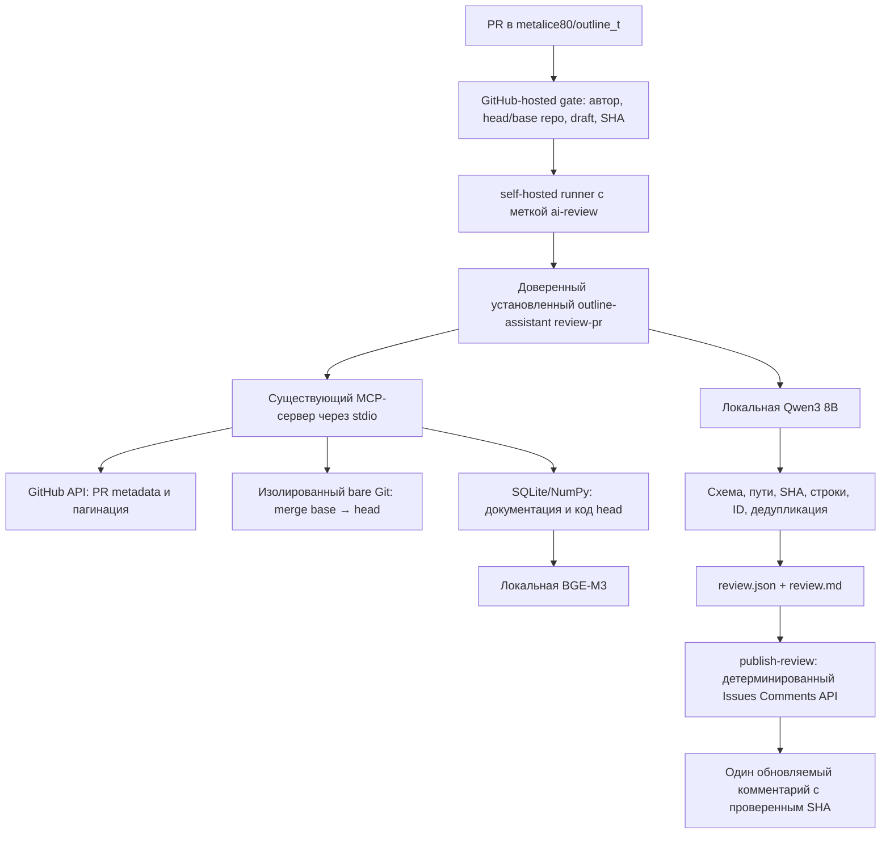

# Автоматическое ревью PR: настройка и эксплуатация

## Что реализовано и где находится

Это расширение существующего `outline-assistant`, а не второе приложение. `/help` по-прежнему использует локальные README/docs. Ревью читает отдельный снимок PR, индексирует также код и сохраняет результат без публикации.

Два разных проекта:

- **Ассистент**: `/Users/sergey/ai/aichallenge/aichallenge31`, код Python, тесты, шаблон `integrations/github/ai-review.yml` и это руководство.
- **Fork**: `metalice80/outline_t`, основная ветка `main` (проверено GitHub API). Workflow находится в `.github/workflows/ai-review.yml` этого fork. По новому разрешению пользователя рабочая копия `/Users/sergey/ai/aichallenge/outline` использует `origin` → `metalice80/outline_t`, исходный `outline/outline` сохранён как `upstream`. Демонстрационные коммиты выполняются здесь в отдельной ветке от свежей `origin/main`, без новых клонов; см. [план демо](DEMO.md). Сам ассистент по-прежнему читает PR через изолированный Git-кеш.

При разработке создан отдельный локальный checkout fork: `.review-work/outline_t`. В нём подготовлен только новый workflow. После отдельного разрешения workflow опубликован в main fork, итоговый commit `74ad672`. Постоянная установка и repository variables настроены. Учебный PR #1 открыт; runner зарегистрирован и работает, оба PR-runs прошли, комментарий создан и обновлён с тем же ID. Текущее состояние — в `evaluation/day32/DEPLOYMENT.md`. Локальные отчёты и тесты не доказывают, что runner зарегистрирован или комментарий опубликован.



## Локальный запуск без публикации

Обновить зависимости существующего venv:

```bash
.venv/bin/python -m pip install -r requirements.lock
.venv/bin/python -m pip install --no-deps --no-build-isolation -e .
.venv/bin/outline-assistant doctor --review
```

Существующий `config.toml` совместим: новые параметры имеют значения по умолчанию. `config.example.toml` содержит полный пример; не перезаписывайте локальные настройки вслепую.

Для существующего PR замените `123` фактическим номером:

```bash
.venv/bin/outline-assistant review-pr \
  --repo metalice80/outline_t --number 123 \
  --output-dir review-output/pr-123
```

Из события Actions дополнительно передавайте полный 40-символьный `--expected-head`. Это должен быть `pull_request.head.sha`, **не** `GITHUB_SHA` синтетического merge-коммита. При ручном запуске workflow получает head через API. Несовпадение SHA даёт `stale`, а не ревью другого коммита.

`review-pr` никогда не публикует комментарии. Выходные файлы: `review.json`, `review.md`; сообщения прогресса идут в stderr. `complete` и `partial` дают exit 0 (частичное покрытие явно отражено); `failed` и `stale` дают exit 1. Даже при технической ошибке сохраняется отчёт, если каталог вывода доступен. `failed` не означает «замечаний нет». Само наличие замечаний не блокирует merge.

## Снимки, контекст и RAG

MCP-инструменты ревью: `get_pr_info`, `get_pr_files`, `get_pr_diff`, `read_file_at_ref`, `list_snapshot_files`, `search_snapshot`, `get_review_health`. Старые `get_git_context`/`list_project_files` сохранены. Инструмента публикации или произвольного shell нет.

Метаданные PR приходят через GitHub REST API. Файловый API обходится по страницам, отсутствие/усечение `patch` отмечается. Источник истины для изменения — локальный Git diff между вычисленным **merge base и head**. API `base.sha` хранится отдельно. При нехватке shallow history Git получает полную необходимую историю. В Git-кеше нет checkout; читаются blob-объекты, отключены hooks, external diff, textconv, submodules и запуск скриптов. Не выполняются тесты и зависимости Outline. Бинарные файлы, symlink, submodule и превышения лимитов явно попадают в пропуски.

Чтение через MCP разрешено только для SHA, закреплённых в текущей сессии PR, и разрешённых путей. Документы: README.md и docs/**/*.md. Код: TS/TSX/JS в app/server/shared/plugins по `review_code_include`, включая colocated tests. Другие расширения и конфигурации JSON/YAML в этом MVP не индексируются; изменение такого файла отражается как skipped/partial. Зависимости, сборки, lock-файлы и пути секретов исключаются. Файлы с распознанными приватными ключами, GitHub-токенами или AWS access key ID также пропускаются; это эвристика, а не универсальное обнаружение секретов.

Tree-sitter выделяет синтаксические блоки и имена символов. Ошибка разбора приводит к ограниченному разбиению строк с `fallback=true`. В источнике сохраняются path, SHA, строки, символ, documentation/code, хеш и признак изменения. Большие блоки ограничены `chunk_chars`; это символы, а не токены. `/api/embed` использует `truncate=false`.

Обязательный контекст каждой порции содержит структурированный diff и затронутые блоки old/new. Если они не помещаются целиком, порция пропускается с причиной, а не объявляется обработанной. Дополнительно передаются RAG-результаты из head, импорты, связанные тесты и ограниченные результаты буквального поиска символов. Для изменённой документации подаются также старые фрагменты из merge base; новое описание не считается доказательством корректности PR. Межфайловые связи анализируются в этих порциях; отдельного глобального прохода по всему репозиторию нет.

Приоритет индекса: изменённые файлы, связанные файлы и тесты, документация, остальные разрешённые исходники до лимита. Если индекс охватил лишь часть разрешённого корпуса, отчёт имеет статус `partial`. Лимит увеличен с 80 до 1000 файлов; это всё ещё часть полного корпуса Outline. Пропущенные результаты поиска и файлов явно указаны в ограничениях, отсутствие найденного вызова не трактуется как отсутствие всех вызовов.

[Реальный замер 80 → 1000 файлов](../evaluation/day32/index-benchmark/REPORT.md): построение с пустым кешем выросло с 47,54 до 402,38 с (×8,46), повторное использование индекса того же SHA — с 0,033 до 0,297 с. Получение файлов через MCP и анализ Qwen измерены отдельно; эти числа не являются временем полного workflow. Действующая конфигурация runner явно задаёт 1000, поэтому установленный пакет использует новый лимит без переустановки.

Индексы: `review_index_dir/snapshots/<owner--repo>/<PR>-<head>/gen-*`, с тем же атомарным `CURRENT`, SQLite, NPY и контрольными суммами, что у `/help`. Старый формат индекса `/help` читается без удаления. Общий SQLite-кеш embeddings использует текст фрагмента, digest модели и параметры парсера/разбиения; неизменённый текст между PR/head повторно не векторизуется. Записи кеша транзакционны; неудачная публикация поколения не повреждает предыдущее. Изменение модели или разбиения меняет ключ кеша.

На `review_index_dir/review.lock` берётся общая блокировка на весь анализ и очистку. Второе ревью на этой машине завершается понятной ошибкой занятости. Рекомендуемая установка — **один runner на одну Ollama**. Workflow ограничен 30 минутами; `concurrency` отменяет предыдущий запуск того же PR. SIGTERM/cancellation освобождает файловые блокировки ОС; поколение до атомарной публикации остаётся неиспользуемым.

## Настройки ревью

| Параметр | Значение по умолчанию | Значение |
|---|---|---|
| `github_repo` | `metalice80/outline_t` | Единственный разрешённый repo для MCP/API |
| `github_api_url` | `https://api.github.com` | API endpoint; локальный HTTP — для фикстур |
| `github_api_version` | `2026-03-10` | Проверенная версия REST API |
| `github_timeout` / `github_retries` | 30 с / 2 | Таймаут и повторения GET; POST/PATCH не повторяются автоматически |
| `github_max_pages` | 30 | Ограничение пагинации; публикация требует полного списка комментариев |
| `review_git_dir` | `.review-cache/git` | Изолированные Git-объекты, вне Outline |
| `review_index_dir` | `.review-cache/rag` | Индексы и общий кеш embeddings, отдельно от `/help` |
| `review_git_timeout` | 180 с | Git fetch/diff; read timeout MCP в review не меньше этого значения + 10 с |
| `review_max_files` | 30 | Файлов с diff на PR |
| `review_max_file_bytes` | 200000 | Максимальный размер читаемого blob |
| `review_max_diff_bytes` | 120000 | Общий бюджет diff; большие файлы пропускаются целиком |
| `review_max_index_files` | 1000 | Файлов в RAG снимка |
| `review_max_tree_files` | 10000 | Имен файлов в ответе MCP |
| `review_max_search_files` | 500 | Файлов для буквального поиска символов |
| `review_max_batches` | 40 | Максимум вызовов анализа порций на PR, без учёта повторов |
| `review_retries` | 1 | Повтор после неверного JSON/источников или ошибки модели |
| `review_keep_days` | 14 | Возраст снимков для явной очистки |
| `publish_enabled` | false | Явное включение публикации в доверенной конфигурации |
| `publication_author` | `github-actions[bot]` | Ожидаемый автор собственного комментария |

`review_git_url` — необязательный доверенный override источника Git (для локальных тестов — путь временного репозитория). В штатном режиме получается HTTPS URL целевого публичного fork. Git fetch не получает токен REST в аргументах/URL. Приватные репозитории с Git-аутентификацией в этой установке не проверялись.

Параметры Ollama, top_k, batch_size, chunk_chars, num_ctx и answer_tokens общие. Бюджет Qwen считается консервативно по UTF-8 байтам сериализованных сообщений, с отдельным резервом ответа и 1600 позиций на служебную обвязку/повтор. `think=false`, `temperature=0`, JSON-schema. Лимиты и причины неполного анализа отражаются в отчёте.

Токен читается только из `GITHUB_TOKEN` или `GH_TOKEN`. Не сохраняйте его в TOML, shell-истории, workflow или отчётах. Публичный API чтения работает без токена до rate limit. SSH-доступ к GitHub не является REST-токеном и не доказывает права API на runners/комментарии.

## Установка доверенной версии на runner (macOS arm64)

Runner — отдельная программа GitHub. Он делает исходящее HTTPS-соединение; открывать Ollama в интернет и менять её адрес на `0.0.0.0` не требуется.

После согласования внедрения создайте **отдельный** каталог установки, не внутри проверяемого fork и не в Actions workspace. Пример для текущей машины:

```bash
mkdir -p /Users/sergey/ai/outline-review-runtime
python3.14 -m venv /Users/sergey/ai/outline-review-runtime/venv
/Users/sergey/ai/outline-review-runtime/venv/bin/python -m pip install \
  -r /Users/sergey/ai/aichallenge/aichallenge31/requirements.lock
/Users/sergey/ai/outline-review-runtime/venv/bin/python -m pip install \
  --no-deps --no-build-isolation /Users/sergey/ai/aichallenge/aichallenge31
```

Используется обычная установка, **без `-e`**: runner не импортирует текущую редактируемую рабочую копию. Устанавливайте проверенную ревизию ассистента; для обновления остановите runner и повторите установку из проверенной версии. Отчёт содержит версию пакета и SHA-256 исходных Python-модулей установленной программы.

Создайте `/Users/sergey/ai/outline-review-runtime/config.toml` на основе примера, укажите абсолютные пути:

```toml
repo_path = "/Users/sergey/ai/aichallenge/outline"
index_dir = "/Users/sergey/ai/outline-review-runtime/help-index"
review_git_dir = "/Users/sergey/ai/outline-review-runtime/git-cache"
review_index_dir = "/Users/sergey/ai/outline-review-runtime/rag-cache"
github_repo = "metalice80/outline_t"
review_max_index_files = 1000
ollama_url = "http://localhost:11434"
embedding_model = "bge-m3"
chat_model = "qwen3:8b"
publish_enabled = false
publication_author = "github-actions[bot]"
```

Проверьте `doctor --review` именно под пользователем runner. Должны быть доступны Git в PATH, localhost:11434 и обе модели. Пользователь runner должен иметь чтение доверенного пакета/конфига и запись только в свои каталоги кеша/артефактов. Не кладите в его окружение постоянные личные токены без необходимости. Для ограничения нагрузки используйте один runner, одну задачу одновременно; настройки ресурсов самой Ollama меняйте явно, а не из PR.

В GitHub откройте **metalice80/outline_t → Settings → Actions → Runners → New self-hosted runner**, выберите macOS/ARM64 и выполните актуальные команды скачивания/проверки checksum, показанные GitHub. Не используйте случайный номер версии runner из старой инструкции. Регистрация выполняется по URL `https://github.com/metalice80/outline_t`, метка — `ai-review`. Временный регистрационный токен вводится по инструкции GitHub и не сохраняется в файлы проекта.

После регистрации запускайте `./run.sh` в терминале runner. Для остановки — Ctrl+C. Фоновая служба `svc.sh install/start` здесь не устанавливается; её установка требует отдельного решения владельца. Подтвердите в Settings, что runner online и имеет метку `ai-review`. Путь к runner произвольный и не должен совпадать с checkout fork.

## Размещение и включение workflow

Из проекта ассистента:

```bash
.venv/bin/python integrations/github/install-workflow.py .review-work/outline_t
```

Скрипт проверяет `origin`, копирует только workflow и отказывается перезаписывать отличающийся существующий файл. Он не делает commit/push. Изучите diff в fork. После разрешения внедрения:

```bash
git -C .review-work/outline_t add .github/workflows/ai-review.yml
git -C .review-work/outline_t commit -m "Add trusted local AI PR review workflow"
git -C .review-work/outline_t push origin main
```

Адрес должен оставаться `metalice80/outline_t`; не отправляйте workflow в `outline/outline`. Если main защищена, внесите workflow через отдельную интеграционную ветку и обычный PR. Чтобы ручной `workflow_dispatch` был доступен, workflow должен присутствовать в default branch. Fork может требовать явного включения Actions; проверяйте его страницу Actions/Settings.

Задайте repository variables:

| Переменная | Для примера установки выше |
|---|---|
| `AI_REVIEW_BIN` | `/Users/sergey/ai/outline-review-runtime/venv/bin/outline-assistant` |
| `AI_REVIEW_CONFIG` | `/Users/sergey/ai/outline-review-runtime/config.toml` |
| `AI_REVIEW_HOME` | `/Users/sergey/ai/outline-review-runtime` |

Workflow сначала выполняет gate на GitHub-hosted `ubuntu-latest`. Только открытый non-draft PR от `metalice80`, у которого и head.repo и base.repo равны `metalice80/outline_t`, получает задание на `[self-hosted, ai-review]`. Для ручного запуска API проверяет те же условия; pull_request payload не требуется. Устаревшее событие отбрасывается по head SHA.

На self-hosted job нет checkout, npm/yarn install, тестов Outline или local actions из PR. Все команды запускают доверенный абсолютный бинарник с доверенным config и cwd вне PR. Параметры передаются через окружение и кавычки. Артефакты и Actions Summary сохраняются при ошибке; успешная диагностика предшествует анализу, публикация идёт только после complete/partial.

Job публикации использует `GITHUB_TOKEN`: `contents: read`, `pull-requests: write`. Это требуемые разрешения, но ограничения Actions/события/репозитория могут их урезать. В Settings → Actions → General проверьте доступные политики Workflow permissions; не обходите отказ увеличением прав личного токена. Для данного обычного комментария не требуется разрешение GitHub Actions на APPROVE/REQUEST_CHANGES.

Только после согласования публикации измените в доверенном runtime-config `publish_enabled=true`. Штатные новые PR и synchronize после этого публикуются автоматически, без ручного подтверждения каждого запуска.

**Граница доверия:** постоянный self-hosted runner в публичном fork предназначен только для учебных изменений доверенного владельца. Фильтр текущего YAML не защищает от PR, который изменит сам workflow: произвольные внешние PR нельзя допускать к такому runner. Для них нужна отдельная изолированная/одноразовая среда и организационная политика Actions. `pull_request_target` не используется как обход токена.

## Публикация и один комментарий

Публикация — отдельный шаг без LLM:

```bash
/path/to/trusted/outline-assistant --config /path/to/trusted/config.toml \
  publish-review --repo metalice80/outline_t --number 123 \
  --expected-head FULL_HEAD_SHA \
  --report /path/to/output/review.json \
  --run-url https://github.com/metalice80/outline_t/actions/runs/RUN_ID
```

В пример нужно подставить действительный SHA и числовой RUN_ID. С `publish_enabled=false` команда отказывается публиковать.

Используется Issues Comments API: обычный комментарий, не inline-review. Маркер: `<!-- local-ai-review:metalice80/outline_t:123 -->`. По всем страницам комментариев ищется именно этот маркер и `publication_author`; чужие комментарии, даже с таким маркером, не редактируются. Свой найденный комментарий обновляется, иначе создаётся новый. Для PAT автор должен соответствовать `/user`; штатный workflow использует `github-actions[bot]`.

В отчёте проверяются repo/PR/schema/result_version, статус и SHA. Head/state повторно читаются перед публикацией и непосредственно перед POST/PATCH. Закрытый PR пропускается; устаревший head не публикуется. Версия результата делает повторную публикацию одного отчёта no-op; более старый результат того же head не затирает новый. Локальная блокировка по repo/PR не допускает двух одновременных публикаций из процессов с общим review-каталогом. API не предоставляет атомарную операцию «проверить head и изменить комментарий», поэтому очень узкая гонка после последнего GET возможна: комментарий всегда явно указывает проверенный SHA. Workflow concurrency уменьшает эту гонку.

Слишком большой комментарий сокращается по байтам, начиная с важнейших замечаний, и содержит ссылку на Actions run с полными артефактами. Текст модели экранируется, `@` заменяется на полноширинный символ, чтобы не вызывать неожиданные упоминания. Исходники цитируются ссылками на commit SHA; удалённые строки — на merge base. Названия, описание и модельный текст не подставляются в shell.

## Очистка

Просмотреть старые индексы:

```bash
.venv/bin/outline-assistant cleanup-review
```

Удалить только перечисленные снимки старше `review_keep_days`:

```bash
.venv/bin/outline-assistant cleanup-review --apply
```

Очистка берёт ту же блокировку, что ревью, не следует symlink и не трогает индекс `/help`, Git-кеш или общий кеш embeddings. Для полного сброса Git/embeddings остановите runner и удалите только настроенные review-каталоги вручную после проверки абсолютных путей. Автоматического удаления всей истории Git нет.

## Проверки и реальное внедрение

```bash
.venv/bin/python -m pytest -q
.venv/bin/python evaluation/day32/run_local.py > evaluation/day32/local-run.log 2>&1
```

Обычные тесты используют фикстуры GitHub и модели, временный Git и настоящий MCP stdio; внешние сервисы не нужны. Для stdio-интеграции поднимается локальный HTTP fixture server, поэтому песочница должна разрешать localhost.

`run_local.py` использует **настоящие Ollama, MCP и Git**, а метаданные PR получает от **явно обозначенной локальной API-фикстуры**. Код сценариев копируется из существующих файлов Outline во временный репозиторий: очевидный баг `shallowEqual`, несовместимая сигнатура `naturalSort`, безопасный рефакторинг и правка документации. Это не проверка GitHub Actions или публикации. SHA тестовых коммитов существуют только локально; ссылки из этих учебных отчётов не являются доступными GitHub-коммитами.

Полный внешний цикл после разрешения и настройки:

1. Установить проверенную версию ассистента, зарегистрировать и запустить runner, настроить variables и разрешить Actions в fork.
2. Добавить подготовленный workflow в main fork и включить публикацию в runtime-config.
3. Создать учебную ветку **в fork от metalice80** с небольшим изменением существующего файла, открыть non-draft PR. Зафиксировать PR number и head SHA.
4. Проверить gate, runner job, summary, review.json/review.md и один комментарий с ожидаемым head SHA. Проверить фактические права токена.
5. Добавить второй commit в ту же ветку. Проверить отмену устаревшего run, новый head в отчёте и обновление **того же comment ID**, без второго комментария.
6. Проверить, что старый отчёт не перезаписывает новое ревью. Не сливать намеренный баг; закрыть учебный PR по решению владельца.

После разрешения опубликован workflow, настроены runtime/variables, зарегистрирован runner и создан PR #1. Два настоящих workflow-runs прошли: комментарий бота создан, а после исправляющего commit обновлён с тем же ID. Проверено отклонение старого expected-head. Текущие результаты — в `evaluation/day32/DEPLOYMENT.md`. Точный фактический статус и результаты — в `evaluation/day32/REPORT.md` и `TODO.md`. В реальной локальной оценке Qwen3 8B остаётся ложное замечание на безопасный рефакторинг: проверенные пути и строки не гарантируют истинность вывода. Рассматривайте комментарий как помощь человеку, а не автоматическое решение о merge.

Официальные источники: [GitHub PR API](https://docs.github.com/en/rest/pulls/pulls), [Issues Comments API](https://docs.github.com/en/rest/issues/comments), [Actions events](https://docs.github.com/en/actions/reference/workflows-and-actions/events-that-trigger-workflows), [self-hosted runners](https://docs.github.com/en/actions/reference/runners/self-hosted-runners), [GITHUB_TOKEN](https://docs.github.com/en/actions/tutorials/authenticate-with-github_token), [Actions security](https://docs.github.com/en/actions/reference/security/secure-use), [Tree-sitter Python](https://github.com/tree-sitter/py-tree-sitter).
