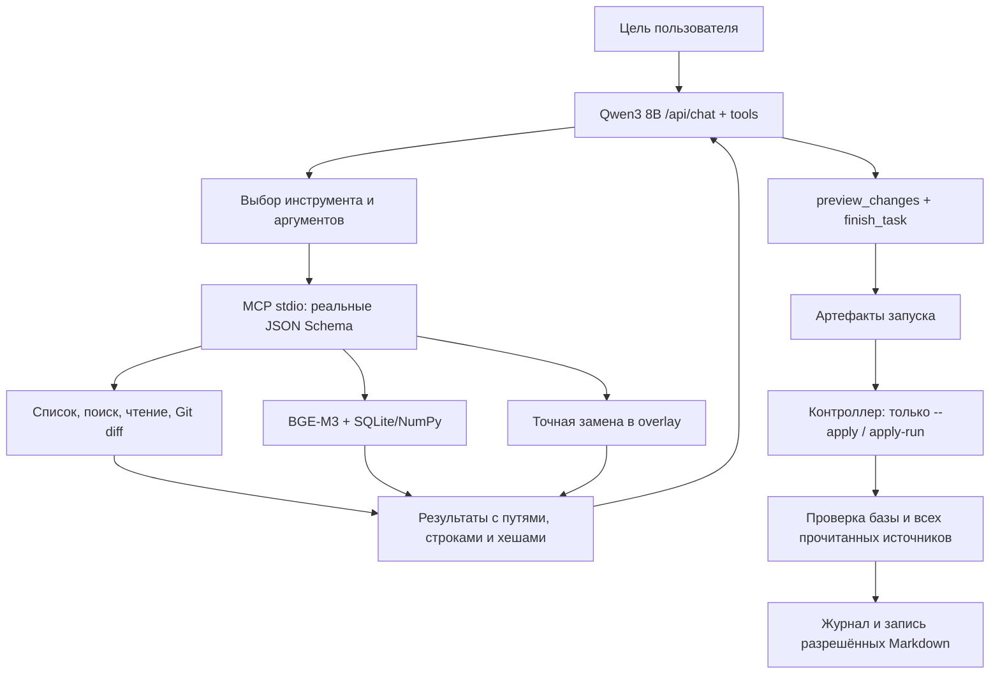

# Задачи над файлами проекта

[Пошаговый план ручной демонстрации](DEMO_FILE_TASKS.md): поиск использований API и обновление существующей документации непосредственно в Outline, без клонирования, с preview и явным применением.

Режим `task` расширяет существующий ассистент. Используются тот же CLI, официальный MCP Python SDK, Ollama, BGE-M3, разбиение кода и индекс SQLite/NumPy. Отдельного приложения или сервиса устанавливать не нужно. Требуются запущенная Ollama, `qwen3:8b`, `bge-m3` и Git-репозиторий в `repo_path`.

## Команды и результат

```bash
.venv/bin/outline-assistant task 'Найди использования shallowEqual, объясни зависимости и создай отчёт'
.venv/bin/outline-assistant task 'Обнови документацию API по изменениям кода рабочей копии'
.venv/bin/outline-assistant task --base HEAD~1 'Обнови документацию по изменениям относительно указанной базы'
.venv/bin/outline-assistant chat
```

В интерактивной сессии: `/task [--apply] [--base REF] <цель>`. Модель сама находит пути; имена из демонстрационного проекта в рабочем коде не зашиты. Существующий `/help` отвечает как раньше.

Без `--base` `get_diff` сравнивает HEAD с рабочей копией, включая staged, unstaged и untracked. Staged и unstaged объединяются в итоговое состояние файла; это не два независимых патча. `--base REF` разрешается в точный commit и сравнивается с рабочей копией. Это не автоматический merge-base и не неявная `main`. Если нужны изменения ветки относительно точки ответвления, заранее выберите и передайте её SHA. В репозитории без первого commit файлы рассматриваются как новые. Игнорируемые Git untracked-файлы не включаются в diff.

По умолчанию результат только подготовлен. CLI печатает run_id, статус и каталог. Смотрите `report.md`, `changes.patch`, затем журнал `events.jsonl`: в нём должны быть реальные успешные `read_file` для определения, использования/теста и документации, а не только поиск или текстовое обещание. Preview отражает только изменения задачи относительно прочитанной рабочей версии; уже существующие пользовательские правки не добавляются в него как новые изменения.

Для **отдельного временного проекта**, указанного в своей конфигурации:

```bash
.venv/bin/outline-assistant --config /path/to/fixture.toml task 'Обнови документацию по изменениям кода'
.venv/bin/outline-assistant --config /path/to/fixture.toml apply-run RUN_ID
# Или разрешите применение сразу, после успешной генерации и проверок:
.venv/bin/outline-assistant --config /path/to/fixture.toml task --apply 'Обнови документацию по изменениям кода'
```

`RUN_ID` заменяется на идентификатор из вывода. Используйте ту же конфигурацию, корень и `task_runs_dir`. `apply-run` не конструирует клиент Ollama, не запускает MCP и не вызывает модель: его можно выполнять при остановленной Ollama. Он применяет сохранённые версии, а не генерирует текст заново. Уже применённый пакет возвращает `no_op: true`, если итоговые файлы, прочитанные источники и HEAD совпадают. Если после применения их отредактировали, результат — `conflict`, чужие изменения сохраняются.

| Статус | Значение |
|---|---|
| `prepared` | Проверенный пакет сохранён; в проект ничего не записано |
| `applied` | Подготовленные файлы записаны; повтор может быть no-op |
| `no_changes` | Модель прочитала источники, вызвала preview и подтвердила отсутствие необходимых изменений |
| `partial` | Есть прочитанные источники, но цикл не завершён; пакет применять нельзя |
| `failed` | Завершить проверяемую задачу не удалось; пакет применять нельзя |
| `conflict` | Изменилась база/источник/цель либо применение/восстановление встретило препятствие |

CLI возвращает 0 для prepared/applied/no_changes, 1 для остальных исходов и ошибок применения. Ошибка в интерактивной сессии не закрывает chat. Частичный overlay сохраняется для разбора, но не получает разрешения на применение.

## Цикл и границы полномочий



Команда завершения предлагается модели после достаточного числа чтений; сервер принимает её только после финального preview: минимум три разных разрешённых файла, если в корпусе их три или больше. Для no_changes дополнительно нужны полный текущий документ и код. Эти проверки предотвращают часть ложных завершений, но не заменяют смысловую проверку текста.

После `get_diff` контроллер сохраняет изменённые пути и диапазоны hunks в manifest. Пока эти диапазоны текущих файлов не прочитаны через MCP, модели доступны только `read_file` и `get_diff`; сервер также отклоняет преждевременные предложения и завершение. Прочитанные части учитываются по строкам и хешу, а при сокращении истории сохраняются ссылки и ограниченный фрагмент diff. Для изменений кода требуется чтение ещё одного файла реализации/конфигурации/тестов, если в доступном корпусе есть второй файл кода. Это проверка наличия источников, а не доказательство их смысловой релевантности. Удалённый файл не требует чтения отсутствующих строк; для не поместившегося в лимит diff контроллер требует чтения файла, но не обещает проверки всех его изменений.

Записи `controller` в `events.jsonl` показывают доступные на шаге инструменты, непрочитанные диапазоны diff и подсказку следующего этапа. Модель по-прежнему выбирает поисковые запросы, документы и связанные файлы; пути Outline и имена API в контроллере не зашиты. Исходники и комментарии к ним остаются недоступны для записи. Полученный Markdown необходимо проверить: формальные ограничения не исключают смысловых ошибок модели.

`read_file` возвращает не более 200 строк за вызов и соблюдает `task_max_result_bytes`. Если запрошен больший диапазон, сервер возвращает ограниченную порцию, фактические `start_line`/`end_line`, `range_limited=true` и аргументы `next_read` для продолжения. Только возвращённые строки входят в доказательства чтения; модель должна дочитать нужные совпадения, а не повторять первую порцию. Для далёких друг от друга совпадений предпочтительны отдельные короткие диапазоны. Одна строка, превышающая лимит байтов, возвращает ошибку, лимиты суммарного чтения сохраняются.

Поиск принимает один glob без раскрытия фигурных скобок. Для совместного поиска TS и TSX используйте `**/*` или отдельные вызовы с `**/*.ts` и `**/*.tsx`. Шаблон `**/*.{ts,tsx}` возвращает ошибку с подсказкой, а не пустой результат, который можно ошибочно принять за отсутствие использований.

Нативный [Ollama tool calling](https://docs.ollama.com/capabilities/tool-calling) передаёт модели схемы, полученные через MCP `list_tools`. Ответы инструментов возвращаются сообщениями `role=tool`, затем вызывается модель снова. `think=false`; поле thinking не сохраняется. Сохраняется журнал действий и результатов, а не скрытые рассуждения.

Инструменты файлового сеанса:

| Инструмент | Назначение |
|---|---|
| `list_files` | Разрешённые пути и overlay, пагинация и признак усечения |
| `search_text` | Буквальные совпадения по нескольким файлам, строки и контекст |
| `read_file` | Актуальные диапазоны, полный SHA-256, короткий edit_hash и source_id |
| `get_diff` | Явное Git-сравнение; строки `-` — исторические, `+` — текущие |
| `search_context` | Семантический поиск BGE-M3 с проверкой версии фрагмента |
| `propose_file_change` | Подготовка создания/точной замены Markdown в overlay |
| `preview_changes` | Список изменений, хеши и unified diff |
| `finish_task` | Фактическое завершение после чтения и последнего preview |

Модель не получает shell, удаление, переключение веток, публикацию или apply-инструмент. В обычных `/help` и `review-pr` нет даже `propose_file_change`. Сервер самостоятельно проверяет пути, размеры, источники и замены. Инструкции внутри исходников и документов считаются недоверенными данными и не могут включить запись.

Все файловые инструменты видят одну overlay-версию. Перед повторной правкой уже подготовленного документа модель снова читает его актуальную версию. RAG строит изолированное поколение в каталоге запуска и перепроверяет текст/строки/хеши результатов по overlay. Dry-run не загрязняет индекс `/help` или PR. После применения инвалидируется указатель `CURRENT` обычного индекса под существующей блокировкой; следующий `/help` перестраивает индекс из реальных файлов. PR-кеши, привязанные к commit, не меняются.

## Что проверяется перед записью

Редактирование существующего документа требует `read_file` и единственной точной замены `old_text → new_text` в прочитанном диапазоне. Полная перезапись непрочитанного документа запрещена. Модель копирует 16-значный `edit_hash` либо полный SHA-256; короткое значение лишь выбирает **уже прочитанную полную версию**. Все проверки источников, исходных целей и итоговых файлов используют полный SHA-256. Некорректный аргумент возвращается модели для исправления; реальное изменение файла приводит к конфликту.

Создание требует `expected_hash=absent` и всё ещё отсутствующего пути. Перед применением проверяются корень (путь/device/inode), HEAD, все существенные прочитанные источники, все цели, хеши подготовленных файлов, исходные копии, текущий allowlist и лимиты. Пакет привязан к исходному рабочему каталогу, его нельзя просто перенести в другой clone. Изменившиеся исходники требуют нового анализа. Конфликт до начала записи не применяет ни одного файла.

Markdown проверяется без выполнения скриптов проекта: закрытие code fences, повторяющиеся заголовки, новые относительные ссылки и якоря, зарегистрированные source_id, явные пути и диапазоны исходников, включая табличные ссылки. Старые несвязанные ссылки документа сохраняются. Поддерживаются обычные inline Markdown-ссылки и простые якоря заголовков; это не полный рендерер всех расширений Markdown. Верификация подтверждает существование источников и диапазонов, но не истинность любого свободно сформулированного утверждения модели. Ссылки на строки относятся к зафиксированному снимку.

Корень ограничивается относительными allowlist-путями. Запрещены `..`, абсолютные пути, symlink, hardlink, скрытые/служебные каталоги, зависимости, сборки, бинарные и не-UTF-8 файлы. Чтение и запись используют directory descriptors с `O_NOFOLLOW`. Известные шаблоны токенов, приватных ключей и секретных значений отклоняются; это дополнительный фильтр, а не универсальный детектор секретов. Не расширяйте allowlist на каталоги секретов.

## Сбой и восстановление

Запись каждого файла использует временный файл, fsync и атомарную замену; создание нового файла — атомарное create-if-absent. **Пакет из нескольких файлов не является одной атомарной транзакцией.** До записи сохраняется durable intent в `apply-journal.json`, после — факт записи. При ошибке контроллер восстанавливает только версии с хешем, который сам записал. Чужая последующая правка не откатывается.

После аварийного завершения повторите `apply-run RUN_ID`. Незавершённый журнал сначала восстанавливается; команда возвращает `conflict` и результат восстановления. Если исходная база целиком восстановлена, следующий явный `apply-run` может применить пакет. При `manual_recovery_required` изучите journal, исходные копии и текущие файлы, сохраните пользовательские правки и запустите новый анализ. Не удаляйте журнал, чтобы скрыть конфликт.

Блокировка сериализует применения в одном `task_runs_dir`. Между последней проверкой хеша и rename существующего файла остаётся короткое системное окно: обычная файловая система не предоставляет compare-and-swap по содержимому против произвольного стороннего редактора. На время применения не редактируйте те же файлы. После сбоя могут остаться пустые созданные каталоги или скрытые временные файлы; они не индексируются. Механизм проверен с инъекцией сбоев и восстановлением журнала, но отключение питания физического компьютера не моделировалось.

## Настройки и пределы поиска

Все пути разрешаются относительно TOML. `task_runs_dir` должен быть отдельным от `repo_path`, основного индекса и обоих PR-кешей. `.task-runs/` исключён из Git этого проекта; если выбрали другой каталог артефактов, исключите его отдельно.

| Параметр | Значение по умолчанию | Ограничение |
|---|---|---|
| `task_read_include` | md, ts, tsx, js, jsx, py, json | Корпус чтения |
| `task_write_include` | README.md, docs/**/*.md, reports/**/*.md | Только Markdown; расширяется пользователем в конфигурации |
| `task_runs_dir` | .task-runs | Пакеты запусков и изолированный RAG |
| `task_max_steps` / `task_max_calls` | 32 / 80 | Запросы к модели / вызовы инструментов |
| `task_timeout` / `task_tool_timeout` | 600 / 180 с | Бюджет цикла / MCP-вызова; HTTP ограничен также http_timeout |
| `task_max_files` | 10000 | Перечисление доступных файлов |
| `task_max_file_bytes` | 200000 | Максимальный читаемый файл |
| `task_max_read_bytes` | 300000 | Суммарные диапазоны read_file, включая повторы |
| `task_max_result_bytes` | 12000 | Текст диапазона/поиска/preview; полный diff сохраняется отдельно |
| `task_max_search_results` | 30 | Файлы с буквальными совпадениями на вызов; matched_lines содержит до 30 строк каждого файла |
| `task_max_search_bytes` | 50000000 | Независимый бюджет сканирования буквального поиска, байты |
| `task_rag_files` | 40 | Файлы в одном смысловом поиске; glob сужает область |
| `task_max_changes` / `task_max_change_bytes` | 8 / 80000 | Файлы / суммарные итоговые байты пакета |
| `task_max_errors` | 4 | Ошибки аргументов/инструментов/ответов без действий |

`read_file` допускает до 200 строк на вызов, поиск RAG — до 10 результатов, list_files — до 100 имён. Три одинаковых вызова с одинаковым результатом останавливают цикл как отсутствие прогресса. История ограничивается оценкой токенов по UTF-8, старые целые обмены удаляются с сохранением ссылок на доказательства; это оценка, а не точный токенизатор Qwen. Полная история остаётся в events. Слишком маленький контекст, большой фрагмент, таймаут или лимит дают partial/failed, а не ложный успех. Ожидающий HTTP-поток при отмене может завершаться до своего сетевого таймаута.

`review_max_index_files=1000` относится к ревью PR и сохранён. Он не равен `task_rag_files`: файловый агент выполняет несколько направленных поисков в выбранных моделью областях. Для точного API используется буквальный поиск, затем чтение импортов, алиасов, re-export и тестов. RAG ранжирует ограниченный корпус, сначала по словам запроса в путях, затем по имени, и отмечает усечение. Это не полный граф типов/вызовов; динамические обращения могут быть пропущены. Отчёт должен явно обозначать охват, а не обещать «все использования».

## Артефакты и воспроизведение

В `.task-runs/<run_id>/` сохраняются:

- `manifest.json`: цель, исходное Git-состояние и сравнение, identity репозитория, модели/digests, версия и хеш кода ассистента, настройки, источники/диапазоны/полные хеши, изменения, статус и ограничения.
- `events.jsonl`: настоящая последовательность вызовов, аргументы, результаты, ошибки и этапы контроллера.
- `changes.patch`: полный diff задачи, включая корректные маркеры отсутствующего перевода строки.
- `report.md`: подготовленные/записанные файлы, источники и ограничения.
- `files/` и `originals/`: полные подготовленные и исходные версии; имя blob = SHA-256 относительного пути из manifest.
- `rag/`: изолированный SQLite/NumPy-индекс и embeddings; `apply-journal.json` появляется при применении.

Артефакты локальны, не публикуются в GitHub и не индексируются как документы проекта. Храните пакет целиком до завершения проверки/восстановления. Автоматической очистки task-пакетов нет. Не редактируйте manifest и журнал для обхода проверок. Повторная генерация LLM не обязана дать такой же текст; точный replay обеспечивает сохранённый пакет.

## Настоящая демонстрация

```bash
.venv/bin/python -m pytest -q
.venv/bin/python evaluation/day34/run_real.py
.venv/bin/python evaluation/day34/run_outline.py
```

`run_real.py` создаёт два независимых временных Git-проекта для сценариев A и B, каждый содержит определение API, re-export, алиас-вызов, тест и документацию. Модель получает только цель. Затем скрипт меняет поведение кода и теста, оставляет staged/unstaged и пользовательскую заметку. Проверяются оба сценария, >=3 чтений, настоящий BGE-M3, dry-run, конфликт источника, применение и повтор без LLM, повторный анализ актуальной документации, настоящий CLI `--apply`. Для replay CLI адрес Ollama намеренно заменяется на недоступный порт 9. В `results.json` записываются путь временного проекта, его TOML и run_id; они позволяют открыть результат и повторить команды вручную. Не нужно создавать или менять clone Outline.

`run_outline.py` использует настроенный Outline только для чтения и подготовки отчёта о реально существующем `shallowEqual`. Скрипт сравнивает HEAD, ветку, статус и суммарный хеш отслеживаемых/неигнорируемых файлов до и после; apply не вызывается. Полные артефакты остаются локально в `.task-runs/outline-day34/`.

Автоматические тесты используют сценарные модели и фиксированные embeddings, но настоящий MCP/stdio и временный Git. Пути/имена в fixture варьируются. Их успех не доказывает качество Qwen. Реальные результаты, неудачные предварительные попытки и ограничения описаны отдельно в [отчёте проверки](../evaluation/day34/REPORT.md).
